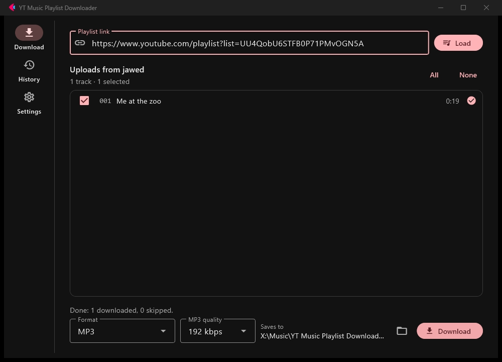
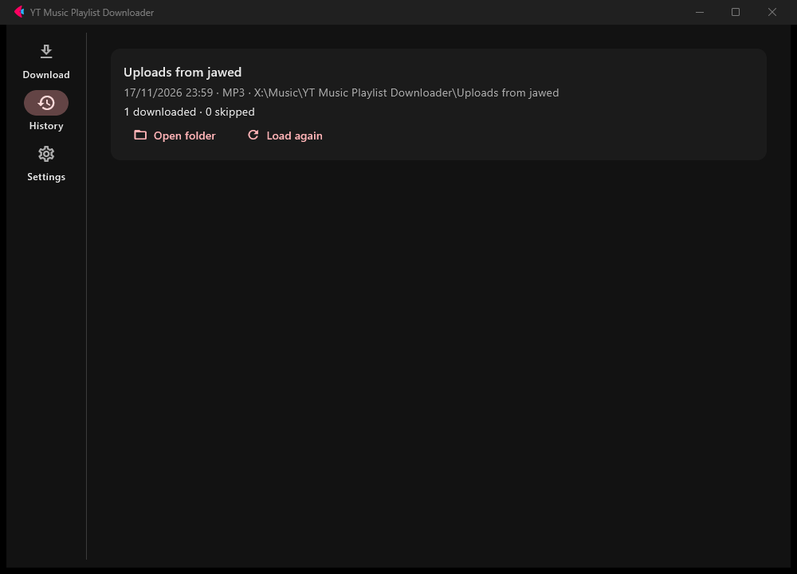
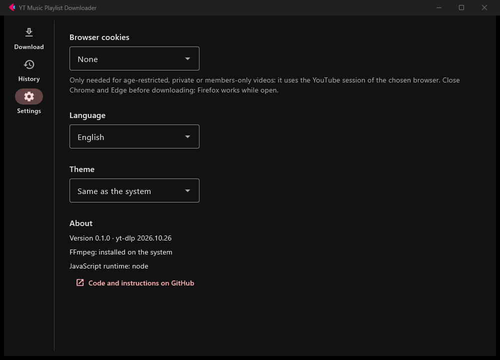

<p align="center">
  
</p>

<h1 align="center">YT Music Playlist Downloader</h1>

<p align="center">
  A desktop app and a command-line script that download a YouTube or YouTube Music playlist as MP3 or M4A.<br>
  It numbers the files in playlist order, writes the tags, remembers what it already downloaded and can use your browser's session for restricted videos.
</p>

<p align="center">
  Read in: English · <a href="README.it.md">Italiano</a>
</p>

<p align="center">
  
  
  
  
  
  
</p>

## Start here

| You want to | Go to |
|---|---|
| **Download with a window and buttons** | [Desktop app](#desktop-app): paste a link, pick the tracks, press Download. |
| **Download from the terminal** | [Install](#install), then [Usage](#usage): two commands and a link. |
| **Know what ends up on disk** | [How it works](#how-it-works): file names, tags, skipped tracks and re-runs. |
| **Download age-restricted or private videos** | [Browser cookies](#browser-cookies): use the session you are already signed in with. |
| **Use it from your own Python code** | [Development](#development): the `ytmpd` package and its events. |
| **Something went wrong** | [Questions](#questions-people-ask): FFmpeg, gaps in the numbering, `NA` files, HTTP 403. |

[How it works](#how-it-works) · [Desktop app](#desktop-app) · [Install](#install) · [Usage](#usage) · [Browser cookies](#browser-cookies) ·
[Development](#development) · [Roadmap](ROADMAP.md) · [Questions](#questions-people-ask)

## How it works

You give it the link of a playlist. It hands it to [yt-dlp](https://github.com/yt-dlp/yt-dlp), downloads the
best available audio of each video and saves it as MP3 or M4A.

| Step | What the script does |
|---|---|
| **1. Check** | For MP3, stops with exit code 2 if `ffmpeg` is not on the PATH, before downloading anything. |
| **2. Link** | A link from `music.youtube.com` or `youtube.com` with a `list=` parameter becomes `https://www.youtube.com/playlist?list=…`, so a link copied from a song playing inside the playlist works too. |
| **3. Download** | Takes the best audio stream. YouTube hides its streams behind a JavaScript challenge: yt-dlp solves it with Deno, Node.js, QuickJS or Bun, whichever is installed. |
| **4. Convert** | **MP3**: FFmpeg converts the audio at the bitrate you chose (192 kbps unless you say otherwise). **M4A**: YouTube's own AAC stream is saved as it is, with no conversion and no quality lost. |
| **5. Tag** | Title and artist (and album, when YouTube Music knows it). MP3s get ID3v2.3 tags, the version Windows Explorer and older players read. No cover art. |
| **6. Skip** | A video that is deleted, private or blocked in your country is skipped and the rest of the playlist goes on. |
| **7. Remember** | Each downloaded track is written to `.ytmpd-archive.txt` in the output folder. Running the same playlist again downloads only the tracks added since. |

The files land in `downloads/` with the playlist position in front of the title:

```text
downloads/
├── .ytmpd-archive.txt
├── 001 - Jain - Makeba (Ian Asher Remix).mp3
├── 002 - Felix Jaehn, Whitney Houston - It's Not Right But It's Okay (Official Video).mp3
├── 004 - David Guetta & Bebe Rexha - I'm Good (Blue) [Djs From Mars Remix] [VISUALIZER].mp3
└── …
```

For each track the terminal shows the title, then percentage, speed and time left, then the saved file name. The
messages are in Italian.

## Desktop app

| | |
|---|---|
|  |  |
| *Download: the tracks, what's done and where it goes* | *History: every download, with what was skipped and why* |
|  | |
| *Settings: cookies, language, theme, and what the app found on the computer* | |

| Screen | What is on it |
|---|---|
| **Download** | The link field, filled in from the clipboard when it holds a YouTube link. **Load** lists the tracks with position and duration; tick the ones you want. Tracks already in the destination folder are marked and left out. Format, MP3 quality and folder sit at the bottom; each playlist gets its own subfolder. During the download every track shows its progress, then a check mark or a red icon whose tooltip says why it was skipped. **Cancel** stops after the current chunk. |
| **History** | The last 100 downloads: playlist, date, format, folder, how many tracks were saved and which were skipped, with the reason. **Open folder** and **Load again**. |
| **Settings** | Browser cookies (see [Browser cookies](#browser-cookies)), language (Italian, English or the system's), theme (light, dark or the system's), and the versions of yt-dlp, FFmpeg and the JavaScript runtime in use. |

The app uses its own FFmpeg (from the `imageio-ffmpeg` package) when there is none on the PATH, so MP3 works without
installing anything else. Settings and history are saved in
`%APPDATA%\Francesco Pazzaglia\YT Music Playlist Downloader\data` by the packaged app, and in `.ytmpd` in your user
folder when it runs from the source code.

A ready-made `.exe` comes with [phase 5 of the roadmap](ROADMAP.md#phase-5--builds-and-releases). Until then, run it
from the source code:

```bash
python -m pip install -r requirements.txt "flet[all]==1.1.2" imageio-ffmpeg
python main.py              # with YTMPD_URL set to a playlist link, it loads that link right away
```

The first start downloads the Flet window runtime once (about a minute).

To build the Windows app yourself you need Visual Studio Build Tools 2022 with the C++ desktop workload and Windows
Developer Mode turned on (Flutter uses symlinks):

```bash
PYTHONUTF8=1 flet build windows --yes   # output in build/windows, about 210 MB with Python and FFmpeg
```

## Install

You need Python 3.10 or later. FFmpeg is needed only for MP3, and a JavaScript runtime (Deno or Node.js) is strongly
recommended: without one, YouTube serves fewer formats and some downloads fail.

```bash
python -m pip install -r requirements.txt
ffmpeg -version
node --version     # or: deno --version
```

| Missing | Install it with (Windows) |
|---|---|
| FFmpeg | `winget install Gyan.FFmpeg`, then open a new terminal so the PATH is reloaded |
| Deno | `winget install DenoLand.Deno` |
| Node.js | `winget install OpenJS.NodeJS.LTS` |

YouTube changes often and old versions of yt-dlp stop working, so update it whenever downloads start failing:

```bash
python -m pip install -U "yt-dlp[default]"
python -m yt_dlp --version
```

## Usage

```bash
python downloader.py "https://music.youtube.com/playlist?list=..."
```

| Option | Values | Default | What it does |
|---|---|---|---|
| `url` | a playlist link | | The playlist to download. Put it in quotes: the `&` in some links breaks the command otherwise. |
| `-o`, `--output` | a folder | `downloads` | Where the files go. The folder is created if it doesn't exist. |
| `-f`, `--format` | `mp3`, `m4a` | `mp3` | MP3 (needs FFmpeg) or M4A (the original AAC audio, no FFmpeg). |
| `-b`, `--bitrate` | `128`, `192`, `256`, `320` | `192` | MP3 bitrate in kbps. Ignored with M4A. |
| `--browser` | `none`, `chrome`, `edge`, `firefox`, `brave`, `opera`, `vivaldi` | `none` | Browser whose cookies yt-dlp reads. See [Browser cookies](#browser-cookies). |
| `--items` | positions, e.g. `1,3,5-8` | all | Download only these tracks. |
| `--list` | | | Print the tracks with their position and duration, without downloading. |

```bash
python downloader.py "URL" --list                       # see what's in it
python downloader.py "URL" --items 1-10 -b 320          # first ten tracks, best MP3 quality
python downloader.py "URL" -f m4a -o "D:\Music\Summer"  # original audio, another folder
python downloader.py "URL" --browser firefox            # with Firefox cookies
```

## Browser cookies

Some videos ask you to sign in: age-restricted ones, private or unlisted playlists, Premium-only uploads. With
`--browser`, yt-dlp reads the cookies of the YouTube session open in that browser and downloads as you.

| Case | What to do |
|---|---|
| **Public playlist** | Nothing: the default `--browser none` is enough. |
| **Age-restricted videos** | Sign in to YouTube in the browser, then add `--browser firefox` (or the one you use). |
| **Your private playlist** | Same as above, with the account that owns the playlist. |
| **Chrome or Edge on Windows** | Close the browser before running the script, because it locks its cookies while open. Recent versions also encrypt them in a way yt-dlp often can't read: if you get a cookie error, sign in with Firefox and use `--browser firefox`. |

The script only reuses access you already have in the browser. It doesn't get around DRM or access checks, and videos
you can't play in the browser won't download either.

YouTube rotates its cookies often, so a session read from the browser can expire in the middle of a long playlist. If
that happens regularly, the [yt-dlp wiki](https://github.com/yt-dlp/yt-dlp/wiki/Extractors#exporting-youtube-cookies)
explains how to export cookies from a private window that stay valid longer.

## Development

The code is in the `ytmpd` package: `core` does the work and prints nothing, `cli` is the command line on top of it.
The [desktop app](#desktop-app) (`ytmpd/gui.py`) uses `core` the same way.

```bash
python -m venv .venv
.venv\Scripts\activate        # Windows; on macOS and Linux: source .venv/bin/activate
python -m pip install -r requirements.txt
python -m unittest            # tests, no network needed
```

```python
import threading
from ytmpd import core

cancel = threading.Event()        # cancel.set() from another thread stops the download
result = core.download("https://music.youtube.com/playlist?list=...", "downloads", fmt="m4a",
                       on_event=print, cancel=cancel)
# result == {"type": "finished", "done": 12, "skipped": 1, "cancelled": False}
```

| Event `type` | Other keys | When |
|---|---|---|
| `track_started` | `index`, `title` | The first bytes of a track arrive |
| `progress` | `index`, `percent`, `speed` (bytes/s), `eta` (s) | Several times per second while downloading; any of them can be `None` |
| `track_done` | `index`, `title`, `path` | The file is in its final place, tagged |
| `track_skipped` | `reason` | yt-dlp gave up on a video |
| `warning` | `message` | yt-dlp warned about something, e.g. no JavaScript runtime |
| `finished` | `done`, `skipped`, `cancelled` | Always last; also the return value |

`core.list_playlist(url)` returns the playlist title and its tracks (`index`, `id`, `title`, `duration`, `thumbnail`)
in a few seconds, without downloading.

<details>
<summary><b>Project layout</b></summary>

| Path | Contents |
|---|---|
| `ytmpd/core.py` | Link normalization, yt-dlp options, playlist listing, download with events and cancel, M4A tags |
| `ytmpd/cli.py` | Command-line options and the Italian messages |
| `ytmpd/gui.py` | Desktop app: the three screens, background threads, settings and history files |
| `ytmpd/i18n.py` | Italian and English text of the app; tests check both have the same keys |
| `main.py` | Starts the desktop app |
| `pyproject.toml` | App name, version and dependencies for `flet build` |
| `downloader.py` | Two-line wrapper, so `python downloader.py` keeps working |
| `tests/test_core.py` | Tests for links, options and tags (`python -m unittest`) |
| `requirements.txt` | `yt-dlp[default]`, which brings `yt-dlp-ejs` (the JavaScript challenge solver) and `mutagen` (M4A tags) |
| `ROADMAP.md` | Plan for the desktop and Android GUI app |
| `DEVLOG.md` | What each phase found out, starting from the Android spike |
| `spike/android/` | Throwaway Flet app used to test `ytmpd.core` on Android |
| `assets/icon.svg` | App icon, also the logo of this README |
| `docs/screenshots/` | Screenshots for the READMEs, in English and Italian |
| `downloads/` | Default output folder, ignored by git |

</details>

<details>
<summary><b>Where to change things</b></summary>

| You want to change | Look at |
|---|---|
| File name pattern | `outtmpl` in `core.build_options()`. The fields are [yt-dlp's output template](https://github.com/yt-dlp/yt-dlp#output-template) ones. |
| Which tags are written | `core.tags_for()` for M4A; the `FFmpegMetadata` postprocessor for MP3. |
| Embedding the cover art | `writethumbnail` in `core.build_options()`, plus the `EmbedThumbnail` postprocessor. |
| Supported browsers and formats | `BROWSERS` and `FORMATS` at the top of `core.py`. |

</details>

<details>
<summary><b>Exit codes</b></summary>

| Code | Meaning |
|---|---|
| `0` | Everything downloaded (or already in the archive). |
| `1` | At least one track was skipped, or the download stopped on an unexpected error. |
| `2` | MP3 chosen and FFmpeg is not on the PATH. |

</details>

## Questions people ask

<details>
<summary><b>"FFmpeg non è presente nel PATH", but I installed it.</b></summary>

The terminal reads the PATH when it opens. Close it, open a new one and try `ffmpeg -version`. If it still isn't found,
the folder with `ffmpeg.exe` (usually a `bin` folder) has to be added to the PATH by hand. Or skip FFmpeg with `-f m4a`.

</details>

<details>
<summary><b>Some numbers are missing, for example there is no 003.</b></summary>

That video couldn't be downloaded: deleted, private, blocked in your country or restricted. The number is its position
in the playlist, so the gap stays. If it was a sign-in problem, try again with `--browser`: the tracks already
downloaded are skipped.

</details>

<details>
<summary><b>A file is called "NA - …" instead of having a number.</b></summary>

The link pointed to a single video, not a playlist, so yt-dlp has no position to put in front of the title. Use the
playlist link, the one with `list=`.

</details>

<details>
<summary><b>I ran it again and it downloaded nothing.</b></summary>

Everything was already in `.ytmpd-archive.txt`. To download a track again, delete its line from that file (or delete
the file to start over). Folders filled by versions before the archive existed get downloaded again once.

</details>

<details>
<summary><b>Downloads fail with "Sign in to confirm you're not a bot" or HTTP 403.</b></summary>

A single 403 can be YouTube having a bad moment: run the command again, the tracks already done are skipped. If it
keeps happening, update yt-dlp (`python -m pip install -U "yt-dlp[default]"`), check that Deno or Node.js is
installed, and then try `--browser` with a browser where you are signed in.

</details>

Use it only for content you are allowed to download, following YouTube's terms of service and the copyright of each
track.

Released under the [MIT license](LICENSE).
